<p align="center"></p>

<p align="center">


</p>

<p align="center"><b>The single reference for how AntaraX looks, sounds and is organised.</b><br>
Every AntaraX product, the antarax.ai website, decks, campaigns and anything written about AntaraX follows this kit.</p>

<p align="center"><a href="guide/">The guide</a> · <a href="guide/products/README.md">Product sheets</a> · <a href="guide/product-brands.html">Visual guide</a> · <a href="tokens/">Tokens</a> · <a href="guide/10-decisions-log.md">Decisions</a> · <a href="guide/15-readme-standard.md">README standard</a> · <a href="https://github.com/haziqfaris/reka-brand-kit">REKA's kit</a></p>

> [!NOTE]
> **A reference, and every product follows it.** This kit is the source of truth for the AntaraX brand: names, statuses, voice, claims, logos, colour, type, BaTech, interface rules and the README standard. It ships no product of its own. Tokens are at **1.11.0** (`tokens/tokens.json`). The default branch is `claude/inspiring-davinci-6ehjo4`; there is no `main` yet.

AntaraX is the AI product line of **REKA Inisiatif Sdn Bhd** (Kuala Lumpur, Malaysia). REKA has its own kit: [haziqfaris/reka-brand-kit](https://github.com/haziqfaris/reka-brand-kit). Where the two meet, [guide/01-positioning.md](guide/01-positioning.md) sets the boundary.

> [!TIP]
> **Here from a product repo?** Skip to [Using this kit from a product repo](#using-this-kit-from-a-product-repo): find your product, follow the map, paste two snippets, take the quiz.

<p align="center"></p>

## What it is

AntaraX has eleven products, six families and many repositories, built at different times by different hands. Without one reference, each product drifts: its own credit line, its own blue, its own way of saying "closed pilot".

This kit is that reference. It holds what AntaraX is and how it sounds, the names and statuses of every product, the logos and colours, BaTech (Malaysian batik rebuilt from technology), the interface rules and the shared product standards. It also holds the masters to copy: tokens, logos, motifs, illustrations, print pieces and the README banners.

The rule is simple: **the kit wins.** Where a product repo, the website or a deck disagrees, the kit is right, unless the owner has since decided otherwise; then the kit changes first.

### The one-minute version

- **Promise:** Put intelligence to work.
- **What we are:** AI products for business. A product company, not a consultancy.
- **Main products:** Yara (jobs and work orders), Janka (inventory forecasting), PLExyz Grid (warehouse and yard space), PLExyz Crowd (people in each space; closed pilot).
- **Architecture:** most products are older than AntaraX. They keep their own names, logos and style, and every one is credited **"by AntaraX"**. AntaraX reaches into each product through one small shared layer: the credit line, BaTech used quietly and by its own guidelines (a signature motif in empty states, Quiet bands), the AI sparkle, shared type and status colours, the intan eyebrow, the app tile and the footer (12).
- **Managed AI:** for now every product is sold as part of REKA's **Managed AI** service.
- **Closed pilots:** AX Frame, PLExyz Crowd, Angka, Tinara, AX Motion. **AI models, by arrangement:** AwanGan (cloud), BumiNyata (on premises). **Managed service:** Cebis Loom.
- **Six families:** Ripple (Operate), Edge (Perceive), Frame (Understand), Loom (Synthesize), Motion (Navigate), Tide (Optimize).
- **Look:** AntaraX blue `#0459F7`, navy text, white ground, Poppins and JetBrains Mono, and the BaTech corak (Malaysian batik rebuilt from technology).
- **Voice:** plain language for non-technical buyers. Problem first, product second. Never invent customers, numbers or maturity.

## Who it is for

Writers, designers, developers and coding agents, in this repository or any repository that uses AntaraX.

### Start here

| If you are… | Read |
|---|---|
| Writing copy, a page or a campaign | [01 Positioning](guide/01-positioning.md), [02 Products and families](guide/02-products-and-families.md), [03 Voice and claims](guide/03-voice-and-claims.md) |
| Designing anything | [04 Logo](guide/04-logo.md), [05 Colour and type](guide/05-colour-and-type.md), [06 BaTech illustration](guide/06-batech-illustration.md), [07 Interface rules](guide/07-interface-rules.md) |
| Building the website | [08 Website, SEO and conversion](guide/08-website-seo-conversion.md), plus `tokens/` |
| Building a product UI | [05 Colour and type](guide/05-colour-and-type.md), [09 Product app alignment](guide/09-product-app-alignment.md), your product's sheet in [products/](guide/products/README.md), `tokens/` |
| Describing a product: who it is for, what it does, what it may claim | The **Brief** at the top of its sheet in [products/](guide/products/README.md) |
| Building a product's words, emails, addresses, plans, formats, help or exports | [13 Shared product standards](guide/13-shared-product-standards.md) and its audit |
| How a product's family, logo, motif, icons, BaTech, loaders, palette and sub-products fit together | [14 Product identity system](guide/14-product-identity-system.md) |
| Working on a product's logo, name or credit line | [12 Brand architecture](guide/12-brand-architecture.md), [products/](guide/products/README.md), [the visual guide](guide/product-brands.html) |
| Building or fixing a product, from its own repo | [Using this kit from a product repo](#using-this-kit-from-a-product-repo) |
| Writing or fixing a repository's README | [15 The README standard](guide/15-readme-standard.md), and the banners in [`readme-kit/`](readme-kit/) |
| Checking what was decided, and when | [10 Decisions log](guide/10-decisions-log.md), [11 Open questions](guide/11-open-questions.md) |

## What it does

### Meet the families

<p align="center">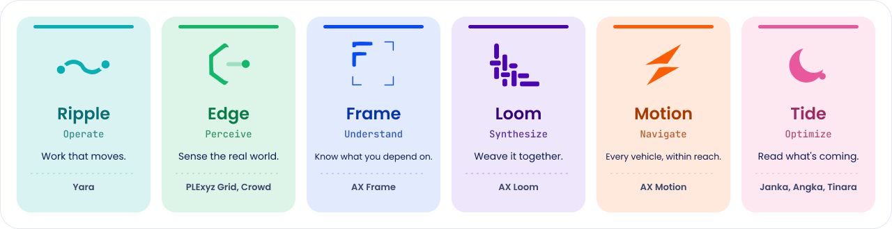</p>

Every product belongs to one family, and the family decides its BaTech shape. Full story in [02 Products and families](guide/02-products-and-families.md).

### Meet the products

Eleven products, every one "by AntaraX". Tap a card for its brand sheet.

<p align="center">
<a href="guide/products/yara.md"></a>
<a href="guide/products/janka.md">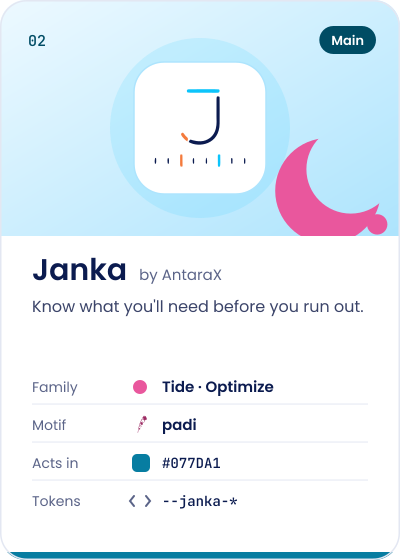</a>
<a href="guide/products/plexyz.md">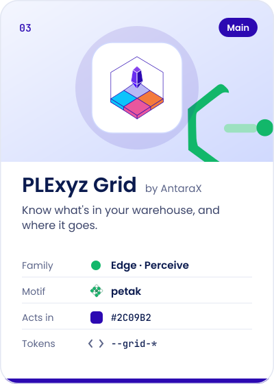</a>
<br>
<a href="guide/products/plexyz.md">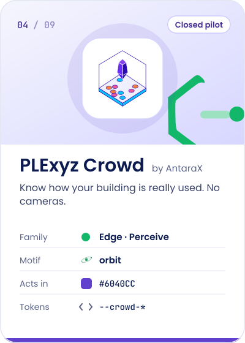</a>
<a href="guide/products/frame.md">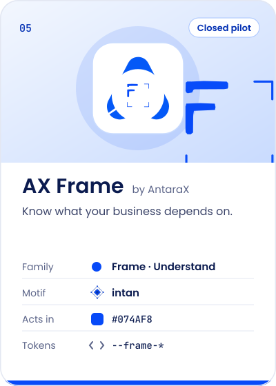</a>
<a href="guide/products/angka.md">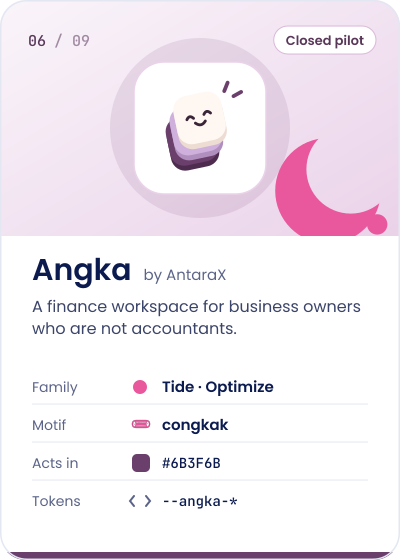</a>
<br>
<a href="guide/products/tinara.md">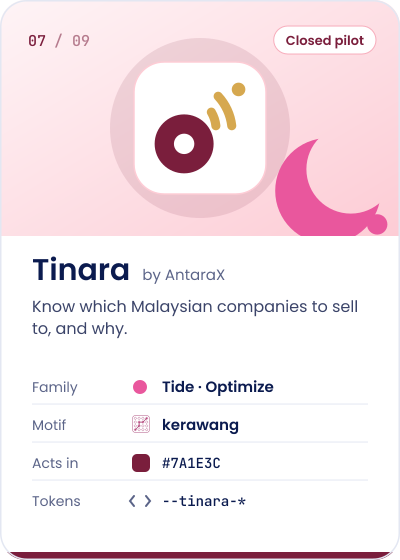</a>
<a href="guide/products/loom.md">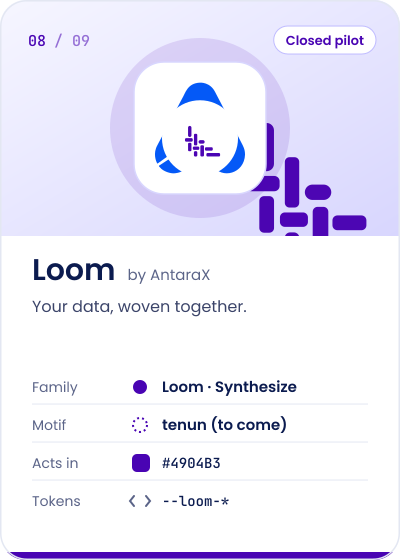</a>
<a href="guide/products/motion.md">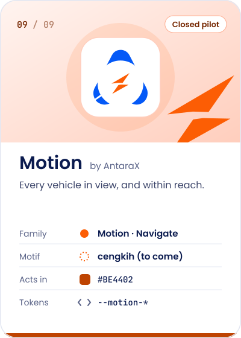</a>
</p>

Two more have no card yet: **AwanGan**, our own AI models in the cloud, and **BumiNyata**, our own AI models on your own servers. Both are AI models, by arrangement; their names, lines and status are in [02 Products and families](guide/02-products-and-families.md).

| Tier | Products |
|---|---|
| **Main products** | Yara (lead), Janka, PLExyz Grid, PLExyz Crowd (still a closed pilot, and says so) |
| **AI models**, by arrangement | AwanGan (cloud), BumiNyata (on premises) |
| **Managed service** | Cebis Loom |
| **Closed pilots** | AX Frame, PLExyz Crowd, Angka, Tinara, AX Motion |

## How it works

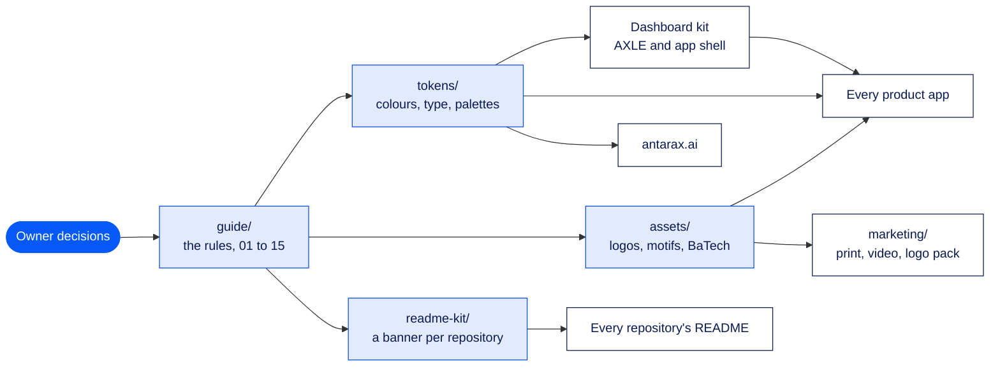

Owner decisions land in the guide first ([10 Decisions log](guide/10-decisions-log.md)). Tokens and assets are copied by consumers, never retyped. The Dashboard kit generates its AXLE and app tokens from this kit's, and every repository's README takes its banner and footer from [`readme-kit/`](readme-kit/), drawn by [`tools/build-readme-kit.mjs`](tools/build-readme-kit.mjs) to [15 The README standard](guide/15-readme-standard.md).

### How to use and change this kit

1. **This kit wins.** If a product repo, the website or a deck disagrees with this kit, the kit is right, unless the owner has since decided otherwise. Then update the kit first, in the same piece of work.
2. **Record decisions.** Every owner decision goes in [10 Decisions log](guide/10-decisions-log.md) with its date. Unresolved questions go in [11 Open questions](guide/11-open-questions.md).
3. **Copy tokens; don't retype them.** Products and sites import or copy `tokens/tokens.css` (or read `tokens.json`). If a value changes, change it here and then in each consumer. AXLE's values are the `axle` section and the customer apps' top bar is the `shell` section; the [Dashboard kit](https://github.com/haziqfaris/AntaraX-Dashboard-kit) generates its AXLE and app tokens from them with `tools/sync-brand-kit.py` and checks the result on every push.
4. **Reference documents are history, not instructions.** `reference/` keeps the documents this kit was built from. Where they disagree with `guide/`, the guide is current.

### Where it is used

| Consumer | Repository |
|---|---|
| antarax.ai website (prototype and live build) | `haziqfaris/antarax-ai` (`prototype/site`, `site/`) |
| Yara | `haziqfaris/yara` |
| Janka (and PLExyz Trace, inside it) | `haziqfaris/janka-inventory-intelligence` |
| PLExyz Grid, PLExyz Crowd | `haziqfaris/plexyz-grid`, `haziqfaris/plexyz-crowd` |
| AX Frame (AXF) | `haziqfaris/axframe` |
| Angka | `haziqfaris/angka` (live at antarax.ai/angka) |
| Tinara | `haziqfaris/tinara` |
| Cebis Loom | `haziqfaris/antarax-cebis-loom` |
| AwanGan, BumiNyata | `haziqfaris/AntaraX-AwanGan`, `haziqfaris/AntaraX-BumiNyata` |
| YaraOne | `haziqfaris/yara-one` |
| AntaraX Ripple (workflow discovery), Gauge | `haziqfaris/ripple-workflow`, `haziqfaris/antarax-ripple-monitoring` |
| AXLE and the customer app shell | `haziqfaris/AntaraX-Dashboard-kit` (its tokens are generated from this kit's) |
| Every repository's README | the banners and footers in [`readme-kit/`](readme-kit/), to [15 The README standard](guide/15-readme-standard.md) |
| REKA (parent brand) | `haziqfaris/reka.re`, `haziqfaris/reka-brand-kit` |

## What's inside this repository

| Path | What it holds | Open it when |
|---|---|---|
| [`guide/`](guide/) | The brand guide, numbered in reading order, 01 to 15 | You need a rule |
| [`guide/products/`](guide/products/README.md) | One brand sheet per product | You are writing about, or building, one product |
| [`guide/product-brands.html`](guide/product-brands.html) | The visual guide: every logo, motif, BaTech set, loader and palette, side by side | You want to compare them all at once |
| [`guide/15-readme-standard.md`](guide/15-readme-standard.md) | The README standard: the parts in order, the rules and the skeleton | You are writing a repository's README |
| [`tokens/tokens.css`](tokens/tokens.css) | AntaraX tokens: colours, family pairs, type, radius, spacing, motion (and [`tokens.json`](tokens/tokens.json)) | You are styling anything |
| [`tokens/product-palettes.css`](tokens/product-palettes.css) | Each product's full palette: scales, roles, neutrals, surfaces, charts (and [`.json`](tokens/product-palettes.json)) | You are styling a product |
| [`assets/`](assets/) | The masters, for screens and code | You need a master file |
| [`assets/antarax/`](assets/antarax/) | The AntaraX A (blue and white), the full lockup, the wordmark (navy and white), the kain A (closed and open), the AI sparkle and its one-colour version | You need the AntaraX mark |
| [`assets/product-logos/`](assets/product-logos/) | Every product logo on the same square, ready to drop in | You need a product's logo |
| [`assets/products/`](assets/products/) | Each product's marks, lockups, motifs and loaders, at their source sizes | You need a motif or a loader |
| [`assets/families/`](assets/families/) | The six family icons, `famicons.json`, and Quiet bands per family | You need a family icon or band |
| [`assets/batech/`](assets/batech/) | Seven BaTech sets (AntaraX and six families): panel, band, spot in colour, quiet, white | You need BaTech ([Step 4](#step-4--choose-your-batech)) |
| [`assets/icons/features/`](assets/icons/features/) | 60 line icons for features and sub-products | You need a feature icon |
| [`assets/reka/`](assets/reka/) | REKA's lockup, orange and white, for the "AI product line of REKA" line (REKA's own kit is the source) | You need the REKA line |
| [`assets/email/`](assets/email/README.md) | Every product email template, rendered, and how a new product joins | You are sending product email |
| [`assets/readme/`](assets/readme/) | The pictures on this page, built by [`tools/build-readme-art.mjs`](tools/build-readme-art.mjs) | You are changing this page's art |
| [`readme-kit/`](readme-kit/) | The README kit: a banner per AntaraX repository (`readme-kit/<slug>/banner.svg`), the shared footers (`footer.svg`, and `footer-reka.svg` for REKA's own repositories) and [`repos.json`](readme-kit/repos.json), the list they are drawn from | You are giving a repository its banner |
| [`marketing/`](marketing/README.md) | Ready to hand over: printers, partners, events (start at `marketing/README.md`) | You are handing something over |
| [`marketing/print/`](marketing/print/) | Print-ready PDFs, one folder per piece: the roll-up bunting, the A3 QR poster | You are printing |
| [`marketing/logo-pack/`](marketing/logo-pack/) | The AntaraX logos as SVG, vector PDF and transparent PNG, for printers and partners | A partner asks for the logo |
| [`marketing/qr/`](marketing/qr/) | The QR codes the print uses, as vectors | You are making a new piece |
| [`marketing/video/`](marketing/video/) | The 60 s intro video: animatic, stills and storyboard | You need video |
| [`marketing/photography/`](marketing/photography/) | `PHOTO_BRIEF.md`: shot list and image-AI prompts for every photo slot on antarax.ai | You are commissioning photos |
| [`tools/`](tools/) | The scripts that build all of the above (each says how to run it at the top), including [`build-readme-kit.mjs`](tools/build-readme-kit.mjs), which draws the README banners and footers | You are rebuilding an asset |
| [`tools/fonts/`](tools/fonts/) | Poppins and JetBrains Mono, for drawing text into SVGs (SIL Open Font License) | A tool needs the fonts |
| [`reference/`](reference/README.md) | The master logo file, and the source documents the guide was built from | You want history, not instructions |
| [`AGENTS.md`](AGENTS.md), [`CLAUDE.md`](CLAUDE.md) | Rules for coding agents, here and in repositories that use AntaraX | You are an agent, or briefing one |

## How to use it

### Just look

- **[The visual guide](guide/product-brands.html):** every logo, motif, BaTech set, loader and palette, side by side. Download it and open it in a browser.
- **[The product sheets](guide/products/README.md):** each product's brief, mark, colours and credit line.
- **[02 Products and families](guide/02-products-and-families.md):** every product's name, one-liner, status and family, in one table.

### Using this kit from a product repo

Every AntaraX product points here for how it looks, sounds and credits AntaraX. This section gets a product repo from "where do I start?" to "on brand" in five steps.

#### Step 1 · Find your product

Your card is in [Meet the products](#meet-the-products): family, motif, the colour you act in and your token prefix. Every product acts in its own colour; the focus ring is always AntaraX blue `#0459F7` (`--<product>-focus`).

Open your product for its kit in one place:

<details>
<summary> <b>Yara</b>: work orders and job cards</summary>

- **Logo:** `assets/product-logos/yara.svg`, the A with the Ripple icon. Motif and loaders: `assets/products/yara/`.
- **BaTech:** the Ripple **Rings**, `assets/batech/ripple/`.
- **Your section in 14:** [Yara](guide/14-product-identity-system.md#yara). **Your to-do list:** [13, what each app needs](guide/13-shared-product-standards.md#what-each-app-needs).
- **Lives at:** `yara.antarax.ai`, sends as `Yara <yara@antarax.ai>`.
- **Biggest quick win:** "Powered by AntaraX Ripple" in the email footer becomes "by AntaraX".
</details>

<details>
<summary>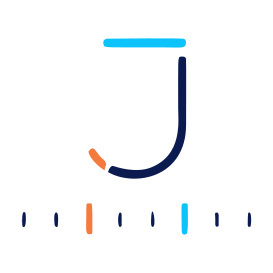 <b>Janka</b>: inventory forecasting (with PLExyz Trace inside)</summary>

- **Logo:** `assets/product-logos/janka.svg`, the J that never closes, kept. Motif and loaders: `assets/products/janka/`.
- **BaTech:** the Tide **Swell**, `assets/batech/tide/`.
- **Your section in 14:** [Janka](guide/14-product-identity-system.md#janka). **Your to-do list:** [13, what each app needs](guide/13-shared-product-standards.md#what-each-app-needs).
- **Lives at:** `janka.antarax.ai`, sends as `Janka <janka@antarax.ai>`.
- **Biggest quick win:** `hello@reka.re` on sign-in becomes support@go.antarax.ai, and the focus ring turns from orange to AntaraX blue.
</details>

<details>
<summary>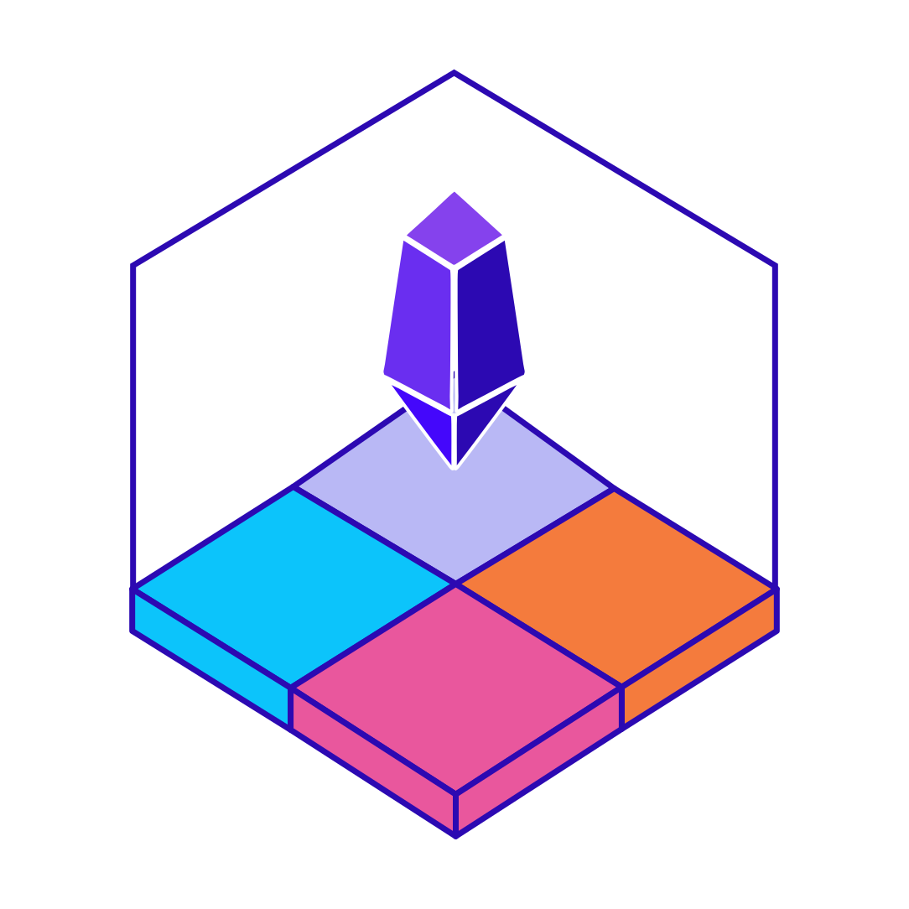 <b>PLExyz Grid</b>: warehouse and yard space</summary>

- **Logo:** `assets/product-logos/plexyz-grid.svg`, the force field, shard and zones, now in AntaraX colours. The owner's originals stay as `*-original.svg` in `assets/products/plexyz/`.
- **BaTech:** no full panel for now. One Edge **spot** in a corner of sign-in, `assets/batech/edge/spot-colour.svg`.
- **Your section in 14:** [PLExyz Grid](guide/14-product-identity-system.md#plexyz-grid). **Your to-do list:** [13, what each app needs](guide/13-shared-product-standards.md#what-each-app-needs).
- **Lives at:** `grid.antarax.ai`, not a `pages.dev` address.
- **Biggest quick win:** focus outlines are removed on inputs; put them back.
</details>

<details>
<summary>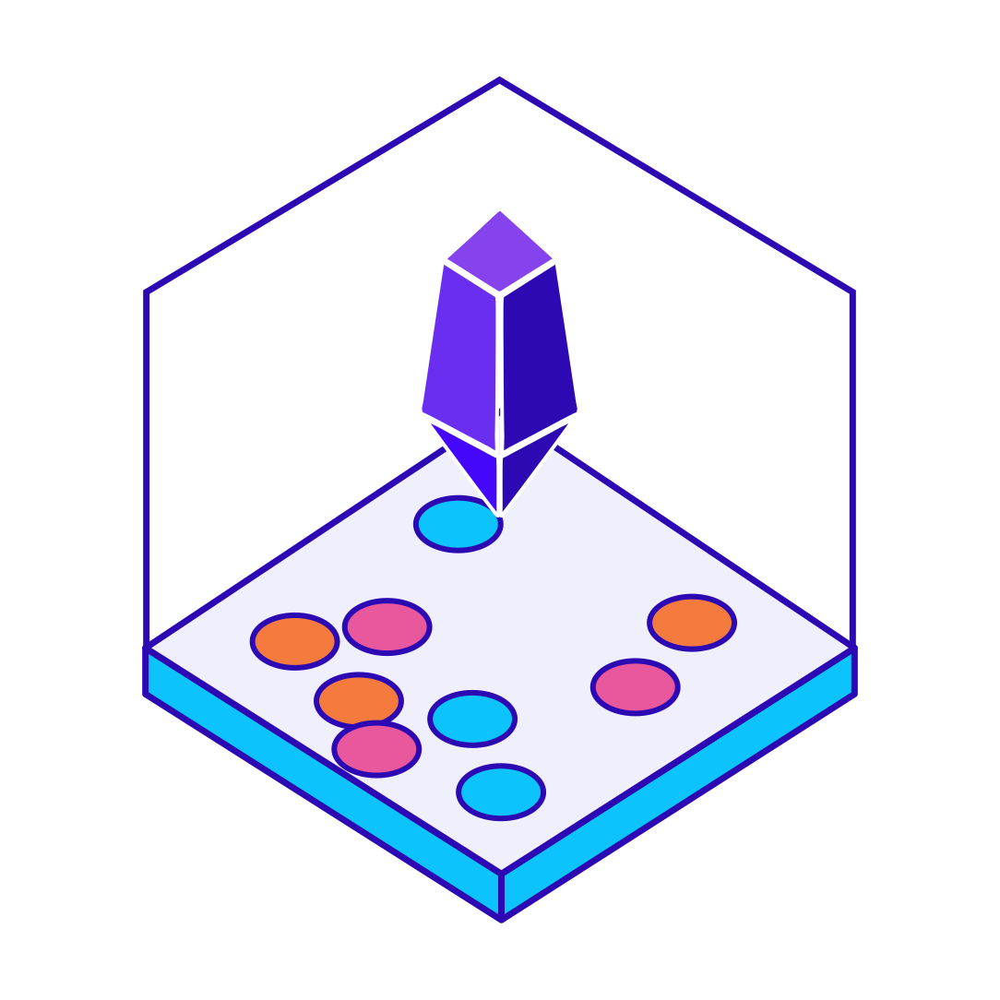 <b>PLExyz Crowd</b>: how a building is really used</summary>

- **Logo:** `assets/product-logos/plexyz-crowd.svg`, the PLExyz mark with people counted as dots, never faces.
- **BaTech:** the Edge **Field**, `assets/batech/edge/`.
- **Your section in 14:** [PLExyz Crowd](guide/14-product-identity-system.md#plexyz-crowd). **Your to-do list:** [13, what each app needs](guide/13-shared-product-standards.md#what-each-app-needs).
- **Lives at:** `crowd.antarax.ai`.
- **Biggest quick win, and the most urgent fix in the portfolio:** the app is titled "AXLE · REKA Operations Console". It is PLExyz Crowd; AXLE is the internal console only.
</details>

<details>
<summary>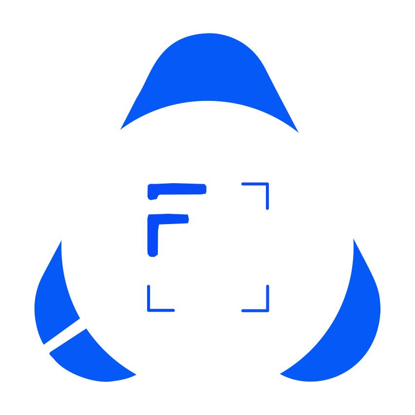 <b>AX Frame</b>: know what your business depends on</summary>

- **Logo:** `assets/product-logos/ax-frame.svg`, the A with the Frame icon. It keeps its breathing cube halo.
- **BaTech:** the Frame **Corners**, `assets/batech/frame/`, and intan in empty states.
- **Your section in 14:** [AX Frame](guide/14-product-identity-system.md#ax-frame). **Your to-do list:** [13, what each app needs](guide/13-shared-product-standards.md#what-each-app-needs).
- **Lives at:** `frame.antarax.ai`, sends as `AX Frame <frame@antarax.ai>`.
- **Already ahead:** money grouped by currency, never converted, is AX Frame's rule and now everyone's.
- **Biggest quick win:** move off the `vercel.app` addresses, and `$` becomes `US$`.
</details>

<details>
<summary> <b>Angka</b>: finance for owners who are not accountants</summary>

- **Logo:** `assets/product-logos/angka.svg`, the sheet stack, kept. Lapis has its own: `assets/product-logos/lapis.svg`.
- **BaTech:** the Tide **Swell**, `assets/batech/tide/`.
- **Your section in 14:** [Angka](guide/14-product-identity-system.md#angka). **Your to-do list:** [13, what each app needs](guide/13-shared-product-standards.md#what-each-app-needs).
- **The exception:** Angka keeps its own plan names (Solo, Business, Team, Enterprise) and "Ask Angka".
- **Biggest quick win:** the email footer "Angka, by REKA Inisiatif Sdn Bhd." becomes the credit line, and `USD 1,200.00` becomes `US$1,200.00`.
</details>

<details>
<summary> <b>Tinara</b>: which Malaysian companies to sell to</summary>

- **Logo:** `assets/product-logos/tinara.svg`, the signal: a garnet company with a gold signal reaching out. Use `tinara-light.svg` on dark grounds and `tinara-small.svg` at 24px and below.
- **Colour:** garnet leads, gold highlights, and gold is never text on white.
- **BaTech:** the Tide **Swell**, `assets/batech/tide/`, with kerawang as its motif.
- **Your section in 14:** [Tinara](guide/14-product-identity-system.md#tinara). **Your to-do list:** [13, what each app needs](guide/13-shared-product-standards.md#what-each-app-needs).
- **Biggest quick win:** the report footer "Tinara Intelligence Engine by REKA" becomes "by AntaraX", and Explorer, Scout, Operator become Seed, Nova, Galaxy.
</details>

<details>
<summary>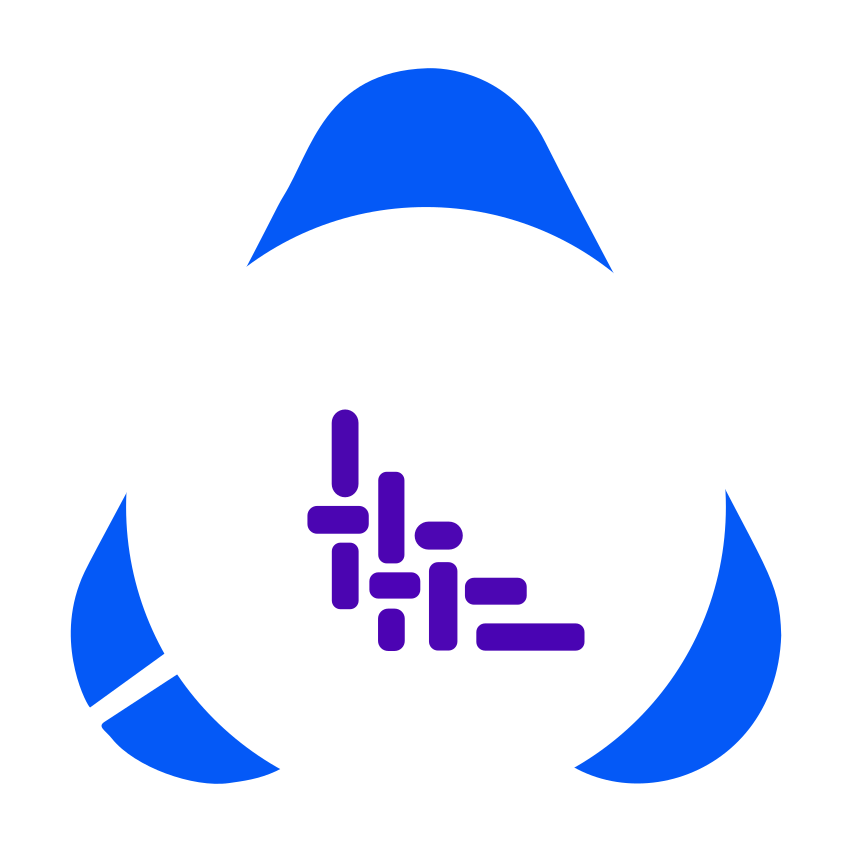 <b>Cebis Loom</b>, a managed service, and 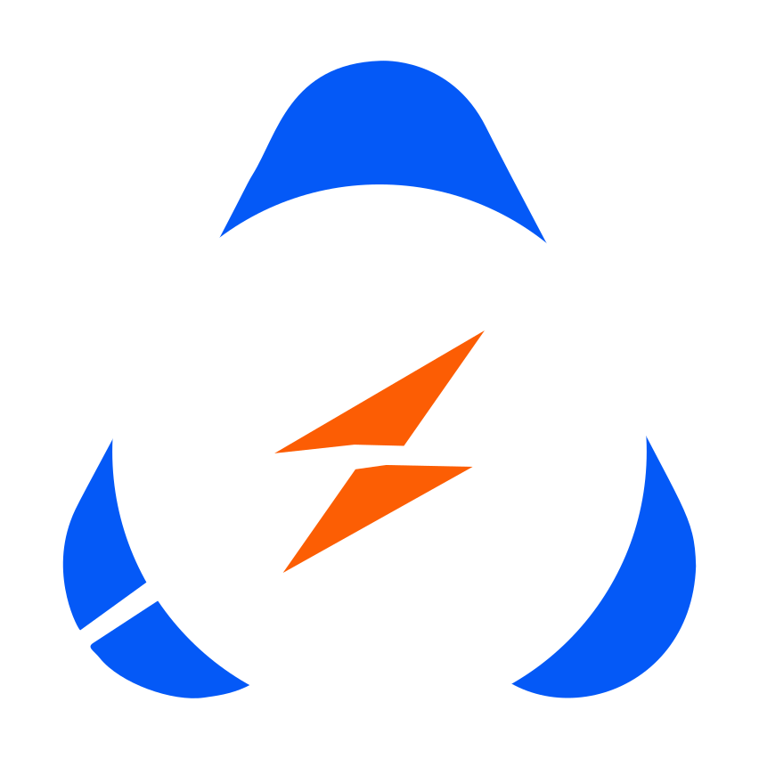 <b>AX Motion</b>, a closed pilot: no full app yet</summary>

- **Logos:** `assets/product-logos/loom.svg` and `assets/product-logos/motion.svg`, A-marks drawn in the same way as Yara's and AX Frame's.
- **BaTech:** Loom's **Thread** and Motion's **Trail**, in `assets/batech/loom/` and `assets/batech/motion/`.
- **Cebis Loom** is sold only as a managed service, by arrangement; its app is early. Repository: `haziqfaris/antarax-cebis-loom`. **AX Motion** has no app yet.
- **Starting an app?** Begin from the A-mark rules in [12](guide/12-brand-architecture.md) and the palette in `tokens/product-palettes.css`, and write a sheet for it in `guide/products/` from the template there.
- **Sheets:** [loom.md](guide/products/loom.md) and [motion.md](guide/products/motion.md).
- **AX Motion:** no claims of deployments, customers, pricing or certification until they exist ([03](guide/03-voice-and-claims.md)).
</details>

#### Step 2 · Follow the map

```mermaid
flowchart LR
    S([You, in a product repo]) --> A[Your product sheet<br/>guide/products/]
    A --> B[12 Brand architecture<br/>the credit line and the AntaraX layer]
    B --> C[13 Shared standards<br/>find your row in the audit]
    C --> D[14 Identity system<br/>your logo, motif, BaTech, loaders, palette]
    D --> T[tokens/ and assets/<br/>copy, never retype]
    T --> Q{Kit doesn't say?}
    Q -->|check| L[10 Decisions log<br/>11 Open questions]
    L -->|still nothing| O([Ask the owner,<br/>then update the kit first])

    classDef you fill:#0459F7,stroke:#0459F7,color:#FFFFFF
    classDef read fill:#E2EAFE,stroke:#074AF8,color:#0B1B4F
    classDef ask fill:#FFE9DC,stroke:#FC5D04,color:#0B1B4F
    class S,O you
    class A,B,C,D,T read
    class Q,L ask
```

Twenty minutes, most of it in your own sheet. Sections 01 to 09 are worth reading once; 12 to 14 are the ones you come back to, and 15 when you write a README.

#### Step 3 · Paste two snippets

**Tell your agents.** Add this to the product repo's `CLAUDE.md` or `AGENTS.md`. Change only the product name and the sheet:

```markdown
## Brand

This product follows the AntaraX brand kit: https://github.com/haziqfaris/AntaraX-brand-kit
Before any work on UI, copy, emails, logos, colours, loaders or plan names, read the kit in this order:
the README's "Using this kit from a product repo", guide/products/yara.md,
guide/12-brand-architecture.md, guide/13-shared-product-standards.md (our row in the audit)
and guide/14-product-identity-system.md (our section).
Copy tokens and assets from the kit; never retype a hex value. Where the kit and this repo
disagree, the kit wins. If the kit doesn't answer a question, ask the owner; don't invent a rule.
AI keys, models and routing are AwanGan's (haziqfaris/AntaraX-AwanGan); API keys, tenants, scopes
and usage rows are Lapisan's (haziqfaris/antarax-api). Their addresses are in guide/13 section 2.
```

**Bring in the tokens.** Copy the two token files (and your logo) from a checkout of this kit, then use the variables. The example is Yara; swap the prefix for yours:

```css
/* Copied from AntaraX brand kit 1.11.0. Don't edit; copy again when the kit changes. */
@import "./brand/tokens.css";
@import "./brand/product-palettes.css";

.button-primary { background: var(--yara-action); color: var(--yara-text-on-action); }
.button-primary:hover { background: var(--yara-action-hover); }
.button-primary:focus-visible { outline: 2px solid var(--yara-focus); outline-offset: 2px; }
.card { background: var(--yara-surface-raised); border: 1px solid var(--yara-border-default); }
.amount { font-family: var(--ax-mono); font-variant-numeric: tabular-nums; }
```

<p align="center"></p>

Dark mode takes each product's `dark-accent` and dark chart colours from `tokens/product-palettes.json`, on navy `#071233`.

#### Step 4 · Choose your BaTech

Every file is `assets/batech/<set>/<variation>-<strength>.svg`. Two questions pick it:

| Where is it going? | Variation | | What is behind it? | Strength |
|---|---|---|---|---|
| Sign-in, splash, report or guide cover, onboarding | `panel` (16:10) | | White, on a cover or marketing | `colour` |
| Page or email header, banner, section break | `band` (6:1) | | White, inside the app | `quiet` |
| Card, empty area, avatar, small square | `spot` (1:1) | | Your product's own colour | `white` |

So Janka's sign-in panel is `assets/batech/tide/panel-colour.svg`, and Yara's in-app header is `assets/batech/ripple/band-quiet.svg`. BaTech never sits behind text or data, and Quiet never goes on a tint, where it disappears. To compare them all at once, open [the visual guide](guide/product-brands.html).

#### Step 5 · Your first hour

Copy this list into an issue in your product repo and tick it off there:

```markdown
- [ ] The Brand snippet is in CLAUDE.md or AGENTS.md
- [ ] I have read our product sheet and our section of 14
- [ ] Our row of the 13 audit is copied into issues, one per ✗
- [ ] The credit line reads "by AntaraX" in the footer, on sign-in and in every email
- [ ] Our logo comes from assets/product-logos/, at its square size
- [ ] Every hex value in our CSS is a token from tokens/
- [ ] Buttons act in our colour; focus rings are AntaraX blue
- [ ] Customers see support@go.antarax.ai, never a personal or platform address
- [ ] Our AI keys are recorded in AwanGan (watch only until we come through it); our API keys come from Lapisan
- [ ] Plans read Seed, Terra, Nova, Galaxy, Quantum, each with who it is for (Angka keeps its own)
- [ ] Money reads RM1,200; dates read 11 Oct 2026; times read 14:30 on screen
- [ ] No loader spins or flips, and every loader stands still under reduced motion
- [ ] AI work shows the sparkle; AI thinking morphs the sparkle into our logo and back
```

#### Pop quiz

Warm up first: the seven slips products make most often.

<p align="center">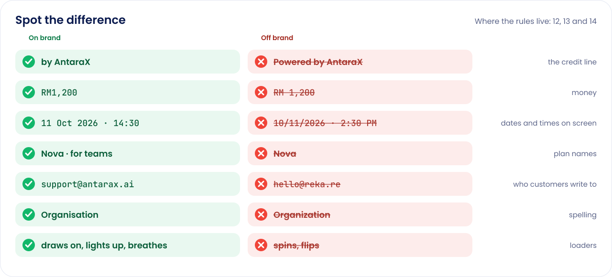</p>

Now eight questions. Answer before you peek.

<details>
<summary><b>1.</b> The footer says "Powered by AntaraX". Ship it?</summary>

No. Every product is credited **"by AntaraX"**. "Powered by", "by REKA" and "AntaraX AI" are never used ([12](guide/12-brand-architecture.md)).
</details>

<details>
<summary><b>2.</b> Your motif is beautiful. Can it be your logo too?</summary>

No. A logo and a motif are always different ([14](guide/14-product-identity-system.md#logo-and-motif)). The logo says *who*; the motif is the picture in empty states and the shape your loaders move in. Tinara learned this one: its logo was once its kerawang, and now it is the signal.
</details>

<details>
<summary><b>3.</b> A designer pitches a loader where your logo spins, then flips. Yes?</summary>

No. **Nothing spins and nothing flips.** Loaders draw on, light in sequence, travel along a path, grow, gather and breathe. Under reduced motion they stand still and the words carry the state ([14](guide/14-product-identity-system.md#loading)).
</details>

<details>
<summary><b>4.</b> The AI has been working for eight seconds. What is on screen?</summary>

The AntaraX sparkle, alive, which every few seconds morphs into your product's logo and back, beside words saying what it is doing: "Forecasting 48 items". The sparkle says AntaraX intelligence is at work; the logo says whose.
</details>

<details>
<summary><b>5.</b> Name the plans, smallest to biggest. Bonus: who is excused?</summary>

**Seed · Terra · Nova · Galaxy · Quantum**, the Rise ladder, always with who it is for ("Nova · for teams"). Products take only the steps they need, in order. Bonus: **Angka**, which keeps Solo, Business, Team and Enterprise ([13](guide/13-shared-product-standards.md#3-plans-money-dates-and-times)).
</details>

<details>
<summary><b>6.</b> Spot the three mistakes: <code>Due: RM 1,200 on 10/11/2026 at 2:30 PM</code></summary>

`RM 1,200` should be `RM1,200` (no space). `10/11/2026` should be `11 Oct 2026` on screen. `2:30 PM` should be `14:30` on screen; 12-hour `2:30 pm` is only for sentences in emails and notifications.
</details>

<details>
<summary><b>7.</b> Your sign-in panel is your product's colour. Which BaTech strength goes on it?</summary>

**White** (white at 32%). Quiet disappears on colour and on tints; Colour is for white or near-white grounds.
</details>

<details>
<summary><b>8.</b> A customer needs help. Which address do they see?</summary>

**support@go.antarax.ai**, for every product: "Need help? Email support@go.antarax.ai and the team will reply." Product emails are sent from `<product>@antarax.ai`, which receives nothing, so they set Reply-To to support. Not a personal inbox, not `hello@reka.re`, and no promised reply time until one is kept.
</details>

**Scoring:** eight right and you are ready to ship. Six or seven: re-read the two you missed. Fewer: back to Step 2, no shame.

#### When the kit doesn't say

1. Check [10 Decisions log](guide/10-decisions-log.md): it may have been decided after your sheet was written.
2. Check [11 Open questions](guide/11-open-questions.md): it may be waiting on the owner. Don't build around an open question; leave it as it is today.
3. Still nothing? Ask the owner. Once it is decided, **update the kit first**, then the product. A rule that lives only in one product repo isn't a rule.

> [!NOTE]
> The kit's default branch is `claude/inspiring-davinci-6ehjo4`; there is no `main` yet. Link to files on the default branch rather than a pinned commit, so your links follow the kit as it changes.

### Run the tools on your computer

You need **Node.js**. Each script in [`tools/`](tools/) says how to run it at the top; the ones that draw text need `opentype.js` installed globally first.

1. Install the font library once: `npm i -g opentype.js@1.3.4`
2. Run the tool you need from the repository root, for example the README art: `NODE_PATH=$(npm root -g) node tools/build-readme-art.mjs`
3. Commit the rebuilt files with the change that caused them. Never edit a built file by hand; change the master or the tool, then rebuild.

### Everyday tasks

| Command | What it does |
|---|---|
| `NODE_PATH=$(npm root -g) node tools/build-readme-kit.mjs readme-kit/repos.json` | Draws the banner for every repository in the list, and the footers. |
| `NODE_PATH=$(npm root -g) node tools/build-readme-kit.mjs readme-kit/repos.json yara tinara` | Draws just these repositories' banners. |
| `NODE_PATH=$(npm root -g) node tools/build-readme-art.mjs` | Draws the pictures on this page (`assets/readme/`). |
| `node tools/build-product-palettes.mjs` | Builds each product's palette, roles and chart set into `tokens/product-palettes.css` and `.json`. |
| `node tools/build-logos.mjs` | Builds the logos that were missing: the Loom and Motion A-marks, the PLExyz line marks, Tinara's options and PLExyz Grid in AntaraX colours. |
| `NODE_PATH=$(npm root -g) node tools/build-square-logos.mjs` | Puts every logo on the same square in `assets/product-logos/`. Needs Playwright with Chromium. |
| `NODE_PATH=$(npm root -g) node tools/build-wordmark.mjs` | Builds the AntaraX wordmark, navy and white. |
| `node tools/build-kain-a-open.mjs` | Builds the open kain A, its eye left empty for a QR code, a photo or a family icon. |
| `node tools/build-feature-icons.mjs` | Builds the feature icons into `assets/icons/features/`. |
| `node tools/build-batech-sets.mjs ../antarax-ai/prototype/site/src/batech.mjs` | Builds the BaTech sets: panel, band and spot, each quiet, white and colour. |
| `node tools/build-product-motifs.mjs ../antarax-ai/prototype/site/src/batech.mjs` | Builds the BaTech pieces products use: motifs, family colour pairs and the Quiet ink. |
| `NODE_PATH=$(npm root -g) node tools/build-logo-pack.mjs` | Builds the logo pack in `marketing/logo-pack/`. |
| `NODE_PATH=$(npm root -g) node tools/build-print.mjs` | Builds the print pieces in `marketing/print/`. |
| `NODE_PATH=$(npm root -g) node tools/build-intro-animatic.mjs [--stills]` | Builds the intro animatic, or its stills. |

## Documentation map

| Group | Document | What it covers |
|---|---|---|
| Start here | [01 Positioning](guide/01-positioning.md) | What AntaraX is, and where REKA's kit takes over. |
| Start here | [02 Products and families](guide/02-products-and-families.md) | Every product's name, one-liner, status and family. |
| Start here | [16 Six-family product architecture](guide/16-product-family-architecture.md) | The 27 October 2026 Nalar classification, scope boundaries, Loom/AX Frame move and Claude Code handover. |
| Start here | [03 Voice and claims](guide/03-voice-and-claims.md) | How AntaraX sounds, and what it may never claim. |
| Design | [04 Logo](guide/04-logo.md) | The AntaraX mark and how to use it. |
| Design | [05 Colour and type](guide/05-colour-and-type.md) | AntaraX blue, navy, the family colours, Poppins and JetBrains Mono. |
| Design | [06 BaTech illustration](guide/06-batech-illustration.md) | The batik rebuilt from technology. |
| Design | [07 Interface rules](guide/07-interface-rules.md) | How AntaraX interfaces behave. |
| Building | [08 Website, SEO and conversion](guide/08-website-seo-conversion.md) | antarax.ai: pages, search and calls to action. |
| Building | [09 Product app alignment](guide/09-product-app-alignment.md) | Bringing a product's app in line with the kit. |
| Building | [12 Brand architecture](guide/12-brand-architecture.md) | The credit line and the AntaraX layer in every product. |
| Building | [13 Shared product standards](guide/13-shared-product-standards.md) | Words, emails, addresses, plans, formats, help and exports, with the audit. |
| Building | [14 Product identity system](guide/14-product-identity-system.md) | Each product's logo, motif, BaTech, loaders and palette. |
| Building | [15 The README standard](guide/15-readme-standard.md) | Every repository's README: the parts, the rules, the skeleton and the banner. |
| Products | [Product sheets](guide/products/README.md) | One sheet per product, each opening with a brief. |
| Products | [The visual guide](guide/product-brands.html) | Every logo, motif, BaTech set, loader and palette, side by side. |
| Decisions | [10 Decisions log](guide/10-decisions-log.md) | Every owner decision, with its date. |
| Decisions | [11 Open questions](guide/11-open-questions.md) | What is waiting on the owner. |
| Hand-over | [Marketing assets](marketing/README.md) | Print, logo pack, QR, video and photography. |
| Hand-over | [Email templates](assets/email/README.md) | Every product email, rendered. |
| History | [Reference documents](reference/README.md) | The documents the guide was built from. Where they disagree with `guide/`, the guide is current. |

## For developers and agents

- [`AGENTS.md`](AGENTS.md): the rules, for work here and in any repository that uses AntaraX. [`CLAUDE.md`](CLAUDE.md) points to it.
- **Change the guide only for an owner decision or to correct a fact**, and record the decision in [10](guide/10-decisions-log.md) in the same change. Anything unresolved goes in [11](guide/11-open-questions.md).
- **Keep `tokens/tokens.json` and `tokens/tokens.css` in step.** After any token change, run `python3 tools/sync-brand-kit.py` in the [Dashboard kit](https://github.com/haziqfaris/AntaraX-Dashboard-kit) and commit there too; its check fails until you do.
- **Built files are never edited by hand.** Change the master or the tool in [`tools/`](tools/), then rebuild.
- **Plain British English, sentence case, no em dashes** in customer-facing copy ([03](guide/03-voice-and-claims.md)).
- Briefing an agent in a product repo? Give it the snippet in [Step 3](#step-3--paste-two-snippets).

## Help and contact

- **The kit doesn't answer your question?** Follow [When the kit doesn't say](#when-the-kit-doesnt-say): the decisions log, the open questions, then the owner. Once it is decided, the kit changes first.
- **Found something wrong?** Open an issue or a pull request in this repository.
- **Product support** is support@go.antarax.ai for every product (quiz question 8 above).

<p align="center">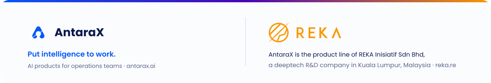</p>
<p align="center"><sub>AntaraX is the product line of REKA Inisiatif Sdn Bhd · <a href="https://antarax.ai">antarax.ai</a> · <a href="https://reka.re">reka.re</a><br>Private and proprietary. © 2026 REKA Inisiatif Sdn Bhd. All rights reserved. · Last updated 27 October 2026<br>Tokens 1.11.0. Version 1.4, 11 October 2026: the product identity system (logos, motifs, BaTech sets, loaders, palettes) and this guide for product repos. Version 1.3 added brand architecture, product sheets, the AntaraX layer and shared product standards.</sub></p>
