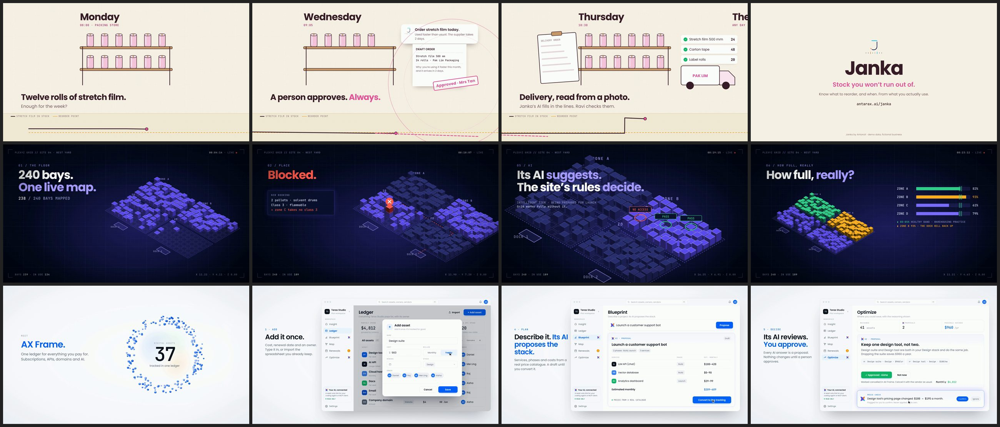

# Product promo films: Janka, PLExyz Grid, AX Frame

15 October 2026. Three short films, one per product, made so that each has its own look, music, structure and mood. They share only a small rendering engine. Every business, person and figure in them is fictional demo data, and each film says so on its end card.

| Film | Length | Look | Structure | Music |
|---|---|---|---|---|
| [`janka/`](janka/) | 40 s | Warm and hand-made: cream and kraft, plum ink, Janka pink, drawn shelves | One continuous camera move along "a week in the store", Monday to Friday, with a stock line running along the bottom | Marimba and kalimba, 88 bpm |
| [`grid/`](grid/) | 30 s | Dark blueprint: navy, a glowing violet grid, an isometric floor of 240 bays, a mono HUD | Hard cuts on the bar, six numbered sections | 120 bpm electronic: kick, saw arpeggio, risers, an impact on every cut |
| [`frame/`](frame/) | 46 s | AX Frame's own world: the light canvas, AX blue, the breathing halo of asset cubes; orange only on the renewal | The halo opens and closes the film; between, a cursor uses the app in five steps: add, see, hear, plan, decide | Calm ambient pads, felt piano, quiet interface sounds, a glass shimmer while the AI thinks |

Each folder has the film with sound (`<name>-intro.mp4`), its English captions (`.en.vtt`, ready for the Bahasa Malaysia and Japanese versions) and a poster frame. The silent and WebM versions are rebuilt from source (below), not kept here.

## What each film says, and why it is allowed to

- **Janka.** It sees the shortfall coming and drafts the order; a person approves. Its AI reads a delivery order from a photo and a person checks each line. It points out stock that isn't moving.
- **PLExyz Grid.** A booking is checked against the site's rules (cargo type, zone, access) before it is saved, and a wrong space is blocked. Its AI suggests and the site's rules decide, labelled "Intelligent tier, being prepared for launch". The 80 to 85% band is called warehousing practice, not an AntaraX result. Ends on "Start with one zone, for free".
- **AX Frame.** In closed pilot. Add an asset once; see it in its stack with an owner; hear about a renewal before the charge; Blueprint proposes a stack from a real price catalogue; Optimize proposes a saving with its reasoning; Price check flags a vendor's price change and never applies it on its own. Every AI answer is a proposal and nothing changes until a person approves. Cancelling is recorded in AX Frame; AX Frame never cancels with the vendor. No warning period in days is stated.

AI work always shows the AntaraX sparkle; while the AI is thinking the sparkle becomes the product's logo and back (README rule). It never spins or flips.

## Rebuilding

The films are HTML pages in [`source/`](source/), rendered frame by frame with Playwright and encoded with ffmpeg. Every frame is a pure function of time, so a render is exact on any machine. The soundtracks are synthesised in Node, no samples.

    cd marketing/video/product-promos/source
    NODE_PATH=$(npm root -g) node render.mjs frame                  # full render into out/frame/: master, MP4 and WebM with and without sound, poster
    NODE_PATH=$(npm root -g) node render.mjs frame --stills 12,30   # review stills into out/frame/
    NODE_PATH=$(npm root -g) node render.mjs frame --from-master    # after changing frame-sound.mjs: re-score and re-encode only
    python3 sheet.py frame                                          # contact sheet of the stills

Open a film in a browser to watch it live (space pauses, arrow keys seek). Needs Node, Playwright with Chromium, and a full ffmpeg.

| File | What it does |
|---|---|
| `engine.css`, `engine.js` | The shared stage: 1920 x 1080, the fonts from `tools/fonts/`, easing helpers, the seek and render hooks |
| `janka.html`, `grid.html`, `frame.html` | One film each; the timeline is at the bottom of each file |
| `sound-lib.mjs` | The instruments and the mix bus |
| `janka-sound.mjs`, `grid-sound.mjs`, `frame-sound.mjs` | One score each, timed to its film |
| `render.mjs` | Frames, master, soundtrack, web files and poster |
| `logos/` | The product logos as they are on antarax.ai |

The renderer reads the colour range from the master's own tags rather than assuming it: forcing full range onto a master this ffmpeg had already written as limited range greyed the whites in an earlier render.
